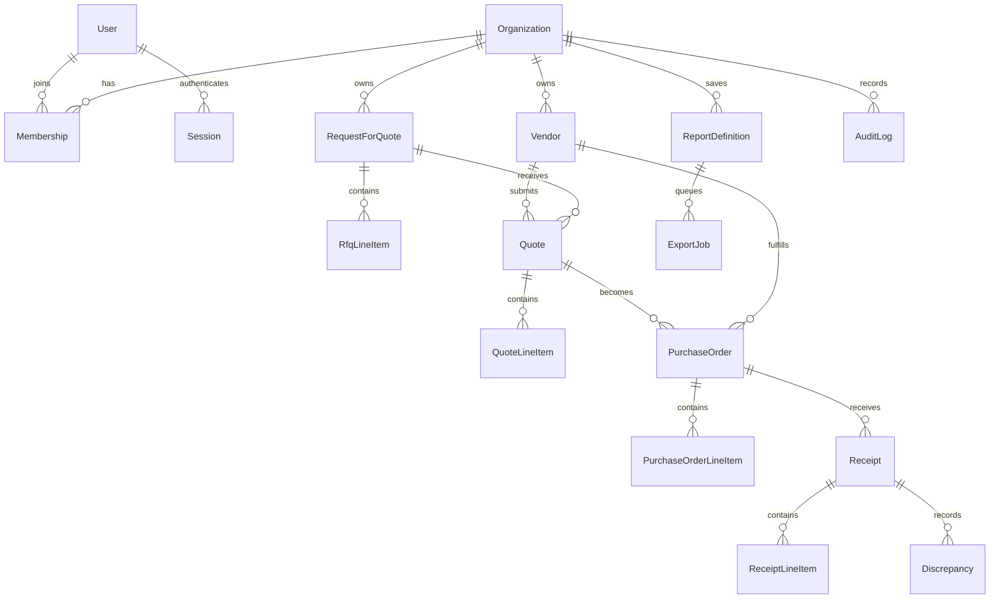

# Domain Model

Entity ownership and primary service:

- `Organization`
  Model: `prisma/schema.prisma` (`model Organization`)
  Primary service: `src/services/seedDemoService.ts`
- `User`, `Membership`, `Session`
  Model: `prisma/schema.prisma` (`model User`, `model Membership`, `model Session`)
  Primary service: `src/services/authService.ts`
- `Vendor`
  Model: `prisma/schema.prisma` (`model Vendor`)
  Primary service: `src/services/vendorService.ts`
- `RequestForQuote`, `RfqLineItem`, `Quote`, `QuoteLineItem`
  Model: `prisma/schema.prisma` (`model RequestForQuote`, `model Quote`)
  Primary service: `src/services/sourcingService.ts`
- `PurchaseOrder`, `PurchaseOrderLineItem`, `Receipt`, `ReceiptLineItem`, `Discrepancy`
  Model: `prisma/schema.prisma` (`model PurchaseOrder`, `model Receipt`, `model Discrepancy`)
  Primary service: `src/services/purchaseOrderService.ts`
- `ReportDefinition`
  Model: `prisma/schema.prisma` (`model ReportDefinition`)
  Primary service: `src/services/reportService.ts`
- `ExportJob`
  Model: `prisma/schema.prisma` (`model ExportJob`)
  Primary service: `src/services/exportJobService.ts`
- `AuditLog`
  Model: `prisma/schema.prisma` (`model AuditLog`)
  Primary service: `src/repositories/auditLogRepository.ts`

The two most important cross-module relationships are:

- Quote to Purchase Order
  `src/services/purchaseOrderService.ts` can select a quote, award the RFQ, and create the PO in one transaction.
- ReportDefinition to ExportJob
  `src/services/exportJobService.ts` queues async export jobs against saved report definitions instead of mixing background state into the definition model itself.
