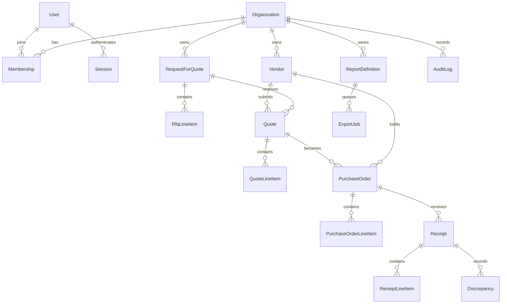

# Domain Model

Entity ownership and primary service:

- `Organization`
  Model: `prisma/schema.prisma` (`model Organization`)
  Primary service: `src/services/seedDemoService.ts`
- `User`, `Membership`, `Session`
  Model: `prisma/schema.prisma` (`model User`, `model Membership`, `model Session`)
  Primary service: `src/services/authService.ts`
- `Vendor`
  Model: `prisma/schema.prisma` (`model Vendor`)
  Primary service: `src/services/vendorService.ts`
- `RequestForQuote`, `RfqLineItem`, `Quote`, `QuoteLineItem`
  Model: `prisma/schema.prisma` (`model RequestForQuote`, `model Quote`)
  Primary service: `src/services/sourcingService.ts`
- `PurchaseOrder`, `PurchaseOrderLineItem`, `Receipt`, `ReceiptLineItem`, `Discrepancy`
  Model: `prisma/schema.prisma` (`model PurchaseOrder`, `model Receipt`, `model Discrepancy`)
  Primary service: `src/services/purchaseOrderService.ts`
- `ReportDefinition`
  Model: `prisma/schema.prisma` (`model ReportDefinition`)
  Primary service: `src/services/reportService.ts`
- `ExportJob`
  Model: `prisma/schema.prisma` (`model ExportJob`)
  Primary service: `src/services/exportJobService.ts`
- `AuditLog`
  Model: `prisma/schema.prisma` (`model AuditLog`)
  Primary service: `src/repositories/auditLogRepository.ts`

The two most important cross-module relationships are:

- Quote to Purchase Order
  `src/services/purchaseOrderService.ts` can select a quote, award the RFQ, and create the PO in one transaction.
  **Correction (by reading):** the three *writes* share one transaction (`purchaseOrderService.ts:43`, with `tx` passed at `:64`, `:105`, `:117`), but the quote *read* and its status check do not. `sourcingRepository.findQuoteById()` takes no client argument and always uses the global `prisma` (`sourcingRepository.ts:134-151`), so the check at `:56-58` reads outside the transaction. The vendor check on the non-quote path (`:76`) has the same shape. Also, because `SELECTED` is an accepted status at `:56`, the same quote can be converted into any number of POs, one after another (by reading; see "Invariants" below).
- ReportDefinition to ExportJob
  `src/services/exportJobService.ts` queues async export jobs against saved report definitions instead of mixing background state into the definition model itself.

---

## What the diagram leaves out

The Mermaid diagram above is accurate as far as it goes, but several relations that matter for correctness are missing:

- `ReceiptLineItem → PurchaseOrderLineItem` (`schema.prisma:298`, `onDelete: Restrict`). This is how cumulative receiving is computed.
- `Discrepancy → PurchaseOrderLineItem` (`:312`) and `Discrepancy → Receipt` (`:311`). Note that `Discrepancy` carries its own `tenantId` (`:305`), but its line item is not constrained to the same tenant or the same PO.
- `Session → Organization` (`:146`). A session is bound to one organization. Switching organizations means logging in again with a different slug.
- Every workflow row points at a `User`: `RequestForQuote.createdById`, `Quote.submittedById`, `PurchaseOrder.requestedById` and `approvedById`, `Receipt.receivedById`, `ReportDefinition.createdById`, `ExportJob.requestedById`, `AuditLog.actorUserId`. All of these are `onDelete: Restrict` except `approvedById` (`SetNull`, `:250`). In practice a user who has done anything cannot be deleted.
- `PurchaseOrder.quoteId` is optional and `SetNull` on delete (`:248`). A PO does not need a quote.

## Tenant column inventory

| Model | Has `tenantId`? | Scoped through |
|---|---|---|
| `Organization` | is the tenant | — |
| `User` | no; global by `email @unique` (`:108`) | `Membership` |
| `Membership` | `organizationId` | `@@unique([userId, organizationId])` (`:135`) |
| `Session` | `organizationId` | — |
| `Vendor`, `RequestForQuote`, `Quote`, `PurchaseOrder`, `Receipt`, `Discrepancy`, `ReportDefinition`, `ExportJob`, `AuditLog` | yes | repository `where` clauses |
| `RfqLineItem`, `QuoteLineItem`, `PurchaseOrderLineItem`, `ReceiptLineItem` | no | their parent row |

Nothing in the schema forces a child row's tenant to match its parent's. `Quote.tenantId` and `Quote.vendorId` are separate columns, for example, and only service code makes sure the vendor belongs to the same tenant (`sourcingService.ts:76-87`). There is no row-level security in PostgreSQL. Isolation is entirely in the `where` clauses.

## State machines

### Purchase order

The legal map is `purchaseOrderTransitionMap` in `src/lib/validation/purchaseOrderSchemas.ts:75-86`:

| From | Allowed to |
|---|---|
| `DRAFT` | `PENDING_APPROVAL`, `CANCELLED` |
| `PENDING_APPROVAL` | `APPROVED`, `CANCELLED` |
| `APPROVED` | `PARTIALLY_RECEIVED`, `RECEIVED`, `CLOSED`, `CANCELLED` |
| `PARTIALLY_RECEIVED` | `RECEIVED`, `CLOSED` |
| `RECEIVED` | `CLOSED` |
| `CLOSED`, `CANCELLED` | nothing |

Which transitions the code can actually perform:

| Transition | Code path |
|---|---|
| (new) → `PENDING_APPROVAL` | `createPurchaseOrder()` writes it directly (`purchaseOrderService.ts:99`). `DRAFT` is the schema default (`schema.prisma:240`) but no code ever creates a draft. |
| `PENDING_APPROVAL` → `APPROVED` | `approvePurchaseOrder()` |
| `APPROVED`/`PARTIALLY_RECEIVED` → `PARTIALLY_RECEIVED`/`RECEIVED` | `receivePurchaseOrder()` |
| anything → `CLOSED` or `CANCELLED` | **no code path.** There is no close or cancel route. |

So four of the seven statuses are reachable from the API: `PENDING_APPROVAL`, `APPROVED`, `PARTIALLY_RECEIVED`, and `RECEIVED`.

**A second partial receipt is impossible.** `PARTIALLY_RECEIVED → PARTIALLY_RECEIVED` is not in the map. `receivePurchaseOrder()` lets a `PARTIALLY_RECEIVED` PO through its own status check (`purchaseOrderService.ts:182-187`), computes `nextStatus` (`:237-239`), and then calls the guard unconditionally (`:241`). If the new receipt still leaves any line short, the guard throws `Invalid purchase order transition from PARTIALLY_RECEIVED to PARTIALLY_RECEIVED`, a plain `Error`, so the client gets 500. In practice a PO can be received in at most two steps: one partial receipt, then one receipt that completes every line. The cumulative-quantity logic at `:194-221`, which is written to handle many receipts, only ever sees zero or one prior receipt on a successful request. Fix: allow the self-transition in the map, or skip the guard when `nextStatus === purchaseOrder.status`. See `docs/learning/guided-reading-path.md`, exercise 4.

The guard throws a plain `Error`, which the HTTP layer turns into a 500. See `docs/architecture/auth-and-permissions.md`.

### RFQ and quote

`rfqTransitionMap` (`rfqSchemas.ts:45-50`) and `assertRfqStatusTransition()` (`:52-61`) exist but are never called. The real RFQ behavior is:

- Created as `OPEN` (`sourcingService.ts:49`), never `DRAFT`.
- Quotes accepted while `OPEN` or `DRAFT` (`:89-91`); `AWARDED` or `CLOSED` → 409.
- Set to `AWARDED` by `selectQuoteAndAwardRfq()` (`sourcingRepository.ts:183-191`) when a quote is converted to a PO. The RFQ's current status is not checked first.
- Never `CLOSED` by any code.

Quotes are created `SUBMITTED` (`sourcingRepository.ts:112`). On conversion, every quote on the RFQ is set `REJECTED`, then the chosen one `SELECTED` (`:161-181`). `DRAFT` and `EXPIRED` are never written. `validUntil` is stored but never compared with the current date: an expired quote can still be submitted (`z.coerce.date()` has no minimum, `rfqSchemas.ts:35`) and still be converted into a PO. The seeded `SELECTED` quote has `validUntil` 2026-05-01 (`seedDemoService.ts:132`), so it is already expired and still usable.

### Export job

`PENDING → RUNNING → SUCCEEDED | FAILED` (`exportJobService.ts:73`, `:89`, `:111`). No transition is guarded: every `mark*` call is an unconditional update by `id` (`exportJobRepository.ts:71-107`). There is no retry and no timeout. A job left in `RUNNING` by a crash is never picked up again, because `findPendingBatch()` reads only `PENDING` (`:57-69`), and it stays counted in the dashboard's "exports running" figure (`dashboardRepository.ts:99-104`).

## Invariants and who enforces them

| Invariant | Enforced at | Gap |
|---|---|---|
| Vendor `code` unique per tenant | DB `@@unique([tenantId, code])` (`schema.prisma:167`) | violation is an unmapped Prisma error → 500 |
| `poNumber` unique per tenant | DB `@@unique([tenantId, poNumber])` (`:256`) | same, 500 |
| PO total = sum(quantity × unitPrice) | recomputed in `createPurchaseOrder()` (`:83-86`) | computed in JS floating point, then `toFixed(2)` |
| Quote total recomputed from lines | `createQuote()` (`sourcingService.ts:93-96`); the route forces `totalAmount: 0` into the schema (`quotes/route.ts:27`) | — |
| One PO per quote | **nowhere** | by reading: two POs created from the same quote in sequence |
| PO approved by someone other than the requester | **nowhere** | by reading |
| PO approved at most once | status check at `purchaseOrderService.ts:131` | outside the transaction; by reading: two overlapping approvals both succeed |
| Received ≤ ordered per line | cumulative check `:204-221` | duplicate entries in one payload bypass it; concurrent receipts (by reading) |
| Discrepancy line item belongs to the PO | **nowhere** | by reading |
| Export job processed once | `findPendingBatch()` reads `PENDING` only | no claim step; by reading: processed twice |
| Audit row written with the change | same transaction for PO create, approve, receive | separate calls for vendor create, RFQ create, quote submit, report create, export queue and completion (`vendorService.ts:32-44`, `sourcingService.ts:38-61`, `:98-120`, `reportService.ts:40-53`, `exportJobService.ts:37-57`, `:89-107`). A crash between the two leaves an unaudited change. |

## Money and number handling

Money columns are `Decimal(12, 2)` in the database. In the code:

- Inputs go through `moneySchema = z.coerce.number().finite()` (`common.ts:19`). There is no lower bound, so a negative `unitPrice` passes validation, and so does `targetUnitPrice` (by reading).
- Totals are summed as JavaScript numbers, then written as strings with `toFixed(2)` (`purchaseOrderService.ts:23-25`, `sourcingService.ts:20-22`).
- Outputs are converted back with `Number(...)` in the serializers (`serializers.ts:1-3`). The list route formats with `toLocaleString()` and a hard-coded `$` even for non-USD POs (`purchase-orders/route.ts:23`).
- Currency codes are upper-cased and must match `^[A-Z]{3}$` (`common.ts:14-18`). No list of real ISO codes is checked.

## What the demo seed creates

`seedDemoService.seed()` (`seedDemoService.ts:17-209`), all in one transaction:

| Record | Tenant | Details |
|---|---|---|
| Organization "Acme Industrial" | `acme-industrial` | `:36-41` |
| Organization "Blue Orbit Foods" | `blue-orbit-foods` | `:43-48` |
| Olivia Grant | Acme, `ORG_ADMIN` | `olivia@acme.test` |
| Marco Li | Acme, `PROCUREMENT_MANAGER` | `marco@acme.test` |
| Erin Shah | Blue Orbit, `ANALYST` | `erin@blueorbit.test` |
| Vendors Alpha Metals (`ALPHA-001`), Bravo Packaging (`BRAVO-002`) | Acme | `:85-106` |
| Vendor Delta Farms Supply (`DELTA-001`) | Blue Orbit | `:178-187` |
| RFQ "Q2 Materials Refresh", `OPEN`, 2 lines | Acme | `:108-122` |
| Quote from Alpha Metals, `SELECTED`, 6650.00 USD | Acme | `:124-141` |
| PO `PO-24017`, `APPROVED` by Olivia, requested by Marco | Acme | `:143-163` |
| Report "Approved Spend Overview", `PROCUREMENT_SPEND`, `minAmount: 1000` | Acme | `:165-176` |
| One `demo.seeded` audit row | Acme | `:189-198` |

All three users share the password `ProcureFlow123!` (`:14`). The seed leaves the RFQ `OPEN` even though one of its quotes is `SELECTED`, which is a state the real conversion path never produces (it would set the RFQ to `AWARDED`). Blue Orbit has no RFQs, POs, or reports, so Erin's reports page is empty apart from the hook's fallback data when a request fails. No seeded user has the `BUYER`, `AP_CLERK`, or `VIEWER` role.

`PO-24017` is the only PO, and it is already `APPROVED`. To exercise approval you have to create a new PO first. To exercise receiving you can post directly against `PO-24017`.
